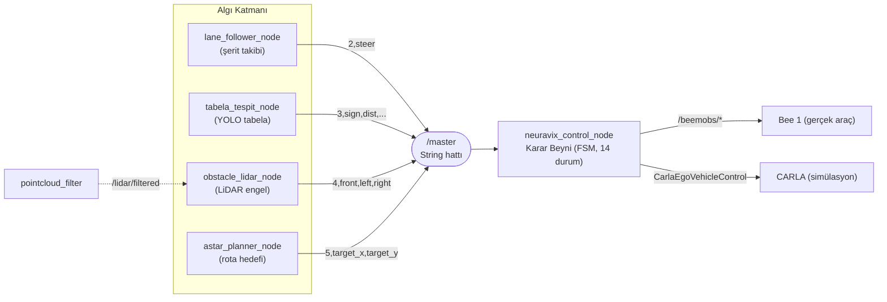

# NeuraVix — Otonom Araç Yazılım Yığını

**Team NeuraVix · TEKNOFEST Robotaksi – Binek Otonom Araç Yarışması**

Bu depo, hem gerçek araç (**Bee 1**) hem de **CARLA** simülasyon ortamı için geliştirilen
otonom sürüş yazılımını içerir. Sistem **ROS 2 Humble** üzerinde çalışır; algı düğümleri
ortak bir `/master` mesaj hattına yazar, karar beyni (FSM) bu hattı okuyup aracı sürer.

> Algı (şerit / tabela / engel) → `/master` → Karar Beyni (FSM) → Araç (Bee 1 + CARLA)

---

## İçindekiler

- [Sistem Mimarisi](#sistem-mimarisi)
- [`/master` Mesaj Protokolü](#master-mesaj-protokolü)
- [Modüller](#modüller)
- [Kurulum](#kurulum)
- [Çalıştırma](#çalıştırma)
- [Tasarım Notları](#tasarım-notları)

---

## Sistem Mimarisi

Tüm algı düğümleri tek bir `/master` (std_msgs/String) hattına yazar. Karar beyni mesaj
ID'sine göre ilgili olayı tetikler, durum makinesini günceller ve çıkışı **aynı anda**
Bee 1 topic'lerine (`/beemobs/*`) ve CARLA'ya (`CarlaEgoVehicleControl`) yayınlar.

---

## `/master` Mesaj Protokolü

Ortak String formatı: `"<id>,<alan1>,<alan2>,..."`

| ID | Kaynak | Format | Açıklama |
|----|--------|--------|----------|
| `2` | `lane_follower_node` | `2,<steer>` | Şerit direksiyon açısı |
| `3` | `tabela_tespit_node` | `3,<sign_id>,<distance>,<cx>,<cy>,<w>,<h>` | Tabela tespiti |
| `4` | `obstacle_lidar_node` | `4,<front>,<left>,<right>` | Engel mesafeleri (m) |
| `5` | `astar_planner_node` | `5,<target_x>,<target_y>` | Planlanan hedef nokta |

**Direksiyon konvansiyonu:** `0..90` aralığı, **45 = düz**, **>45 = sol**, **<45 = sağ**.
CARLA'ya çevrim: `carla_steer = -(steer - 45) / 45`, `[-1, 1]` aralığına kırpılır.

> ⚠️ `/master`'ın `"2,<steer>"` formatı gerçek araç donanımıyla ortaktır; protokol
> **değiştirilmemelidir**.

---

## Modüller

### Karar & Kontrol

#### `neuravix_control_node.py`
Sistemin beyni. İki parçadan oluşur:
- **`Alkar_Function4`** — 14 durumlu sonlu durum makinesi (`LANE_FOLLOW`, `RED_LIGHT_STOP`,
  `STOP_SIGN`, `CROSSWALK_STOP`, `BUS_STOP`, dönüş/şeritten geçiş durumları, `OBSTACLE_STOP`,
  `OBSTACLE_AVOID`, `PARK_SEARCH`, `PARKING`, `EMERGENCY` ...). Tabela sayacı, cooldown ve
  açı yumuşatma içerir.
- **`DecisionControlNode`** — ROS 2 köprüsü. Abone: `/master`, `/carla/.../odometry`,
  `/safety/emergency_stop`. Yayın: Bee 1 için `/beemobs/RC_THRT_DATA`,
  `/beemobs/RC_STR_DATA`, `/beemobs/AUTONOMOUS_BrakePedalControl`, `/beemobs/RC_SIGNAL_STATUS`;
  CARLA için `CarlaEgoVehicleControl`.

Öne çıkan kontrol mantığı:
- **Pure-pursuit + şerit harmanı:** A* rotasından gelen direksiyon ile şerit algısı
  %55 / %45 oranında harmanlanır.
- **Algı tazelik denetimi (watchdog):** şerit verisi `0.5 s`'den eskiyse şerit girdisi
  yok sayılır, salt rota takibine düşülür.
- **Kapalı çevrim gaz kontrolü:** ileri-besleme + PI (`Kff=0.06`, `Kp=0.18`, `Ki=0.04`),
  hedef hıza karşı CARLA hız geri beslemesiyle.
- 20 Hz kontrol döngüsü (`create_timer(0.05, ...)`).

### Algı

#### `lane_follower_node.py`
Şerit takibi. YOLO segmentasyon maskesi → **Kuş Bakışı (BEV/IPM) homografi** dönüşümü →
ağırlıklı polinom uydurma (alt bölgeye daha fazla ağırlık) → sol/sağ şerit ortası →
**PID** ile direksiyon. Hatalı/çapraz uzun çizgileri eleyen eğim ve genişlik filtreleri
içerir. Çıktı: `/master` → `"2,<steer>"` (15–75 arası kırpılır). `r` tuşuyla overlay video
kaydı.

#### `tabela_tespit_node.py`
Trafik tabelası / ışık tespiti. **YOLO** + **zamansal filtre** (IoU eşleştirmeli tampon,
`min_hits` ile yanlış pozitif bastırma) + görüntü ön işleme (CLAHE, gürültü azaltma,
keskinleştirme). 24 sınıf (`TRESPASS` … `KIRMIZI/SARI/YESIL_ISIK` … `TUNEL`). Mesafe,
bbox yüksekliğinden tahmin edilir. Çıktı: `/master` → `"3,<sign_id>,<distance>,...".`

#### `obstacle_lidar_node.py`
LiDAR nokta bulutundan sektörel engel analizi. ROS REP-103 (x ileri, +y sol):
- **front:** koridor içinde en yakın engel
- **left / right:** yan klerans
- Zemin (`z_min`) ve yüksek nesne (`z_max`) filtreleri, `flip_y` parametresi.

Sabit hızda (10 Hz) yayın. Çıktı: `/master` → `"4,<front>,<left>,<right>"`.

#### `pointcloud_filter.py`
LiDAR ön işleme (numpy vektörize). Ham buluttan **araç gövdesini kırpar**, **zemin altını
atar** ve FAST-LIO'nun istediği **`time` alanını** üretir (azimut açısından per-point zaman
damgası). Çıktı: `/lidar/filtered` (x, y, z, intensity, time).

### Planlama

#### `astar_planner.py`
A* global planlayıcı çekirdeği. Araç boyutu tabanlı **inflation**, statik harita + yerel
costmap birleşimi, 8-yön komşuluk, yol yumuşatma ve **hız profili** üretimi.
`OCC_FREE / OCC_OBSTACLE` occupancy standardı; `set_static_map()`, `plan_path()` →
`path_world` + `velocity_profile`.

#### `astar_planner_node.py`
A*'ın ROS 2 entegrasyonu. `/map` (OccupancyGrid) alınır, planlama çözünürlüğüne
kabalaştırılır (varsayılan 0.20 m). Başlangıç: RViz "2D Pose Estimate" (`/initialpose`)
veya TF; hedef: RViz "2D Goal Pose" (`/goal_pose`). Çıktı: `/planned_path` (nav_msgs/Path)
+ `/velocity_profile`.

### Simülasyon Ortamı

#### `build_pist_map.py`
TEKNOFEST pistini **OpenDRIVE** olarak üreten ana script (`pist.xodr` + önizleme + layout
JSON). 3×2 blok grid, 2 iç dikey yol, 1 orta yatay yol, **TÜNEL** (IV1×Orta 4-yön kavşağı),
**ROUNDABOUT** (IV2×Orta), 3 D durak ve doğu kenarında park anneksi. Tüm kavşaklar gerçek
`<junction>` + bağlantı yolları + `laneLink` ile kurulur. Şerit genişliği 2.75 m
(saha ölçümlerinden).

---

Team NeuraVix · TEKNOFEST Robotaksi · ROS 2 Humble · CARLA
