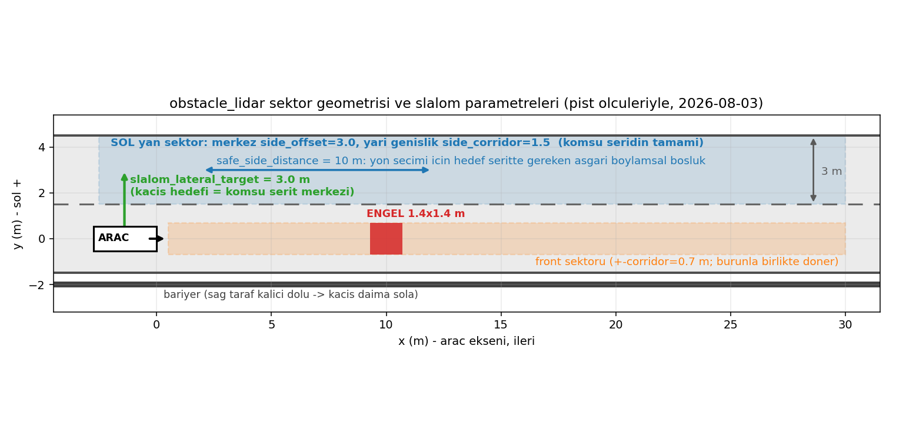
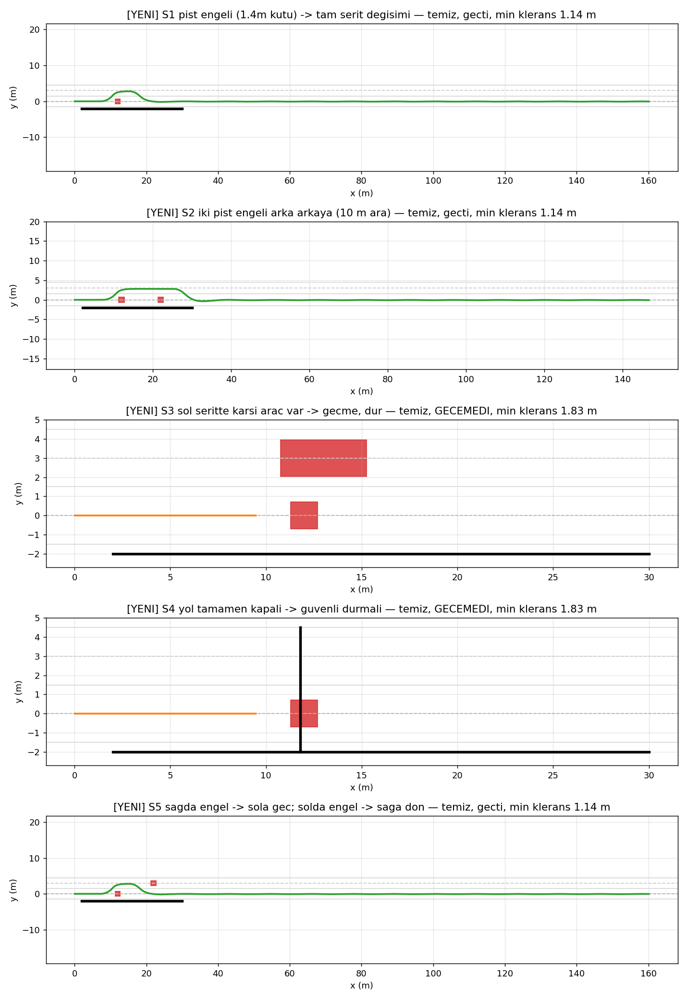

# Engelden Kaçınma (Slalom) Modülünün Yeniden Tasarımı ve Benzetim ile Doğrulanması

**Takım NeuraVix — TEKNOFEST 2026 Robotaksi | Tarih: 2026-08-03**

---

## Özet

Bu çalışmada, otonom aracın engelden kaçınma (slalom) davranışında sahada gözlemlenen
başarısızlıkların kök nedenleri analiz edilmiş, karar beyni (`decision_brain.py`) üzerinde
yapısal değişiklikler gerçekleştirilmiş ve bu değişiklikler CARLA'ya ihtiyaç duymadan,
bu amaçla geliştirilen bir masaüstü benzetim aracı (`slalom_sim.py`) ile doğrulanmıştır.
Eski mantık, benzetimde beş senaryonun üçünde engele çarpmakta iken; yeniden tasarlanan
dört fazlı manevra mantığı beş senaryonun tamamında engeli çarpışmasız geçmiş veya
geçişin güvenli olmadığı durumlarda manevraya hiç girmeden durmuştur.

---

## 1. Giriş ve Problem Tanımı

Araç, önündeki engeli lidar ile algıladığında şerit değiştirerek engelin yanından
geçmeli (slalom) ve ardından kendi şeridine geri dönmelidir. Ancak saha testlerinde
(2026-07-20 tarihli `debug_control5` kayıt analizi) şu belirtiler gözlemlenmiştir:

- Araç engel karşısında 18–24 saniye boyunca `OBSTACLE_AVOID` durumunda kalmış,
  direksiyon 70 ile 20 birim arasında sürekli savrulmuş (testere davranışı),
  ancak manevra hiç tamamlanamamıştır.
- Bir manevra denemesinde araç 6.0 saniyede yalnızca 0.00 m yol katetmiştir;
  yani direksiyon savrulurken araç fiilen yerinde saymıştır.
- Engel geçilebilir nitelikte olmasına rağmen araç ya engele doğru geri kırmış
  ya da manevrayı yarıda bırakmıştır.

## 2. Tespit Edilen Sorunlar ve Kök Nedenleri

### 2.1 Geçiş (pass) fazının bulunmaması

Eski manevra iki fazlıdır: *kaç* (yana kır) ve *dön* (şeride geri kır). Gerçek bir
slalom ise üç harekettir: yana çık, engelin yanından **paralel geç**, geri dön.
Kodda geçiş adımı hiç bulunmadığından, araç yaklaşık 2 m'lik kaçıştan sonra — henüz
engelin hizasına gelmeden — şeride geri kırmakta ve engelin üzerine yönelmekteydi.
"Engel boylamsal olarak geçildi mi?" sorusu hiçbir yerde sorulmamaktaydı.

### 2.2 Dönen ön sektör yanılgısı

Lidar'ın "ön" (front) sektörü araç gövdesine göre tanımlıdır ve araçla birlikte
döner. Kaçış fazının bitiş koşullarından biri `front > slow_distance` idi. Araç
kaçış için 15–20° döndüğünde engel, burnun doğrultusundaki sektörden çıkmakta ve
`front` değeri anında 99'a (temiz) sıçramaktaydı. Kod bunu "önüm açıldı" olarak
yorumlayıp — araç yanal olarak neredeyse hiç kaymamışken — dönüş fazına geçmekte,
dönüşte engel tekrar sektöre girmekte ve döngü baştan başlamaktaydı. Saha
kayıtlarındaki testere davranışının birincil mekanik nedeni bu yanılgıdır.

### 2.3 Kaçınma sırasında çarpışma korumasının bulunmaması

`obstacle_event` işleyicisi, durum `OBSTACLE_AVOID` iken erken dönmekteydi:
manevra boyunca engel mesafeleri karara hiç yansımamakta, dönüş fazında engelin
üzerine sürülürken hiçbir fren mekanizması devreye girmemekteydi.

### 2.4 Geç tetikleme ve geometrik yetersizlik

Kaçınma tetiği 3.0 m'de kurulmuştu; 0.5 saniyelik onay süresi boyunca araç
yaklaşmaya devam ettiğinden manevra fiilen ~2.2–2.5 m'den başlamaktaydı. Aracın
tam kilit dönüş yarıçapı R = L/tan(δ) = 1.86/tan(31.25°) ≈ 3.1 m olduğundan, bu
mesafede engelin yanından dönmeye geometrik olarak yer kalmamaktadır.

### 2.5 Gerçek araçta manevra hızının fiilen sıfırlanması

Gerçek araç düğümünde tüm hız hedefleri güvenlik amacıyla 0.15 katsayısı ile
ölçeklenmektedir. Karar beyninin 4 km/h'lik slalom hedefi bu ölçekle 0.6 birime
inmekte, araç bu hedefle sürtünmeyi yenememekte ve hareket edememekteydi
(Bölüm 1'deki "6 saniyede 0.00 m" bulgusunun doğrudan nedeni).

### 2.6 Yan sektörlerin yanlış konumu

Yan sektörler araca bitişik, ±1.4 m merkezli dar koridorlara bakmaktaydı. Oysa
kaçışın hedefi komşu şerittir: "sol boş mu?" sorusunun komşu şeridin kendisine
sorulması gerekir. Ayrıca yön seçim eşiği (2.0 m) yetersizdi: hedef şeritte
10 m ileride araç bulunsa dahi taraf "boş" sayılmaktaydı.

### 2.7 Hız komutu yarış durumu

Engel işleyicisi "5 m'de yavaşla" kararı verdiğinde, şerit takip işleyicisi her
karede hedef hızı tekrar seyir hızına yazmaktaydı. İki işleyici benzer frekansta
çalıştığından hedef hız 12 ile 6 km/h arasında titremekte, araç engele
yavaşlamadan yaklaşmaktaydı.

## 3. Yöntem: Yapılan Değişiklikler

Değişikliklerin tamamına yakını, hem benzetimde hem gerçek araçta ortak kullanılan
karar beyni dosyasında (`src/neuravix_ros2/neuravix_ros2/decision_brain.py`)
yapılmıştır; iki kontrol düğümü yalnızca beyne ek veri (yaw) besleyecek şekilde
güncellenmiştir.

### 3.1 Dört fazlı manevra ve S-viraj geometrisi

Manevra *kaç → geç → dön → hizalan* olmak üzere dört faza ayrılmıştır:

1. **Kaç (escape):** Tam kilit direksiyonla yanal hedefe yönelinir. Klasik çift
   şerit değiştirme geometrisi uygulanır: yanal hedefin yarısına ulaşıldığında
   karşı kırmaya geçilir; böylece hedefe burun şerit yönüne paralel varılır.
2. **Geç (pass):** Komşu şeritte, burun şerit yönüne P-kontrol ile kilitlenmiş
   olarak engelin yanından paralel geçilir.
3. **Dön (return):** Simetrik S-viraj ile başlangıç şeridine inilir.
4. **Hizalan (align):** Burun şerit yönüne kilitlenir; manevra ancak araç
   hizalandığında sonlanır. Bu sayede manevra sonu "önümde hâlâ engel var mı?"
   kontrolü, ön sektör doğru yöne bakarken yapılır.

### 3.2 Faz bitişlerinin gerçek yanal ofsete bağlanması

Bölüm 2.2'deki yanılgıyı ortadan kaldırmak için faz bitişleri ön sektör verisine
bağlanmaktan tamamen çıkarılmıştır. Kontrol düğümleri beyne artık araç yönünü
(yaw) beslemekte; beyin, manevra başındaki yöne göre yanal ofseti yol integrali
ile ölçmektedir (Δy = Σ sin(ψ − ψ₀)·Δs). Kaçış fazı "yeterince yana çıktım mı",
dönüş fazı "şeride geri geldim mi" sorularını bu gerçek geometrik büyüklükle
yanıtlar. Yaw verisi yoksa yol mesafesi, o da yoksa süre yedeği kullanılır
(kademeli bozulma).

### 3.3 Manevra sırasında çarpışma koruması

`obstacle_event` işleyicisine, `OBSTACLE_AVOID` durumunda da çalışan bir koruma
eklenmiştir: ön sektörde 1.0 m'nin (acil eşik) altında engel görülürse manevra
güvenli duruşla yarıda kesilir. Eşik olarak `stop_distance` (2.2 m) bilinçli
olarak kullanılmamıştır; manevra boyunca burun kasıtlı olarak açılı döndüğünden
ön sektör geçici olarak yol kenarını/bariyeri taramakta ve 2.2 m'lik eşik her
sağlıklı manevrayı kesmektedir (benzetim bulgusu). Lidar'ın veri kesilmesi
durumunda yayımladığı `front = 0` sinyali de her fazda duruş tetikler.

### 3.4 Giriş koşullarının düzeltilmesi

- Engel `stop_distance` (2.2 m) altındayken manevraya girilmesi yasaklanmıştır;
  bu mesafede tek güvenli davranış durmaktır (Bölüm 2.4'teki geometri).
  Benzetimde bu kural olmadan aracın dur-kalk döngüsünde adım adım engele
  sürüklendiği gözlemlenmiştir.
- Yavaşlama bandı 5.0 → 6.0 m'ye, kaçınma tetiği 3.0 → 4.5 m'ye çekilmiştir.
  1.4 m genişliğindeki pist engelinin köşesi ön koridor kenarında uzun süre
  kaldığından, 4.0 m'lik tetik dahi kaçış ortasında acil eşiğe inilmesine yol
  açmaktaydı; 4.5 m ile manevra acil eşiğe hiç inmeden tamamlanmaktadır.
- Onay süresi 0.5 → 0.3 s'ye indirilmiştir; lidar düğümü zaten k-of-n zamansal
  filtre (~0.2 s) uyguladığından toplam onay ~0.5 s'de kalmaktadır.

### 3.5 Yan sektörlerin komşu şeride taşınması ve pist kalibrasyonu

Pist ölçüleri (`carla-pist/pist_layout.json`: şerit genişliği 3.0 m, slalom
engeli 1.4×1.4 m; gerçek pistte beyaz çizgi arası ~2.96 m ölçülmüştür) esas
alınarak:

- Lidar yan sektör merkezi `side_offset` 1.4 → **3.0 m** (komşu şerit merkezi),
  sektör yarı genişliği yeni `side_corridor` parametresi ile **1.5 m** (komşu
  şeridin tamamı) yapılmıştır. Böylece `left`/`right` değerleri "o şeritte
  önümde kaç metre boşluk var" anlamı kazanmıştır (Şekil 1).
- Kaçışın yanal hedefi `slalom_lateral_target` **3.0 m** yapılmıştır: araç,
  lidar'ın "boş" kararını verdiği koridorun tam merkezine gider. Bu iki
  parametrenin eşitliği tasarım gereğidir; biri değiştirilirse diğeri de
  değiştirilmelidir.
- Yön seçim eşiği `safe_side_distance` 2.0 → **10.0 m** yapılmıştır: şerit
  değişimi ~7–8 m ileri yol tuttuğundan, hedef şeritte bundan az boşluk varken
  (ör. karşıdan gelen araç) manevraya hiç girilmemektedir.

*Şekil 1: Üstten görünüm. Ön sektör (turuncu) burunla birlikte döner; sol yan
sektör (mavi) komşu şeridin tamamını tarar. Kaçış hedefi (yeşil ok) yan sektör
merkeziyle aynı noktadır.*

### 3.6 Zincirleme slalom: dönüş öncesi hedef şerit kontrolü

Arka arkaya dizilmiş engellerde (şartname slalomu), ilk engel geçilip şeride
dönüldüğünde ikinci engele manevra mesafesi kalmamaktadır. Bu nedenle geçiş fazı
sonuna bir kontrol eklenmiştir: dönülecek şeridi tarayan yan sektörde
`slalom_return_free` (8 m) değerinden az boşluk varsa şeride dönülmez, komşu
şeritte paralel geçişe devam edilir; boşluk açıldığında dönüş başlar. Böylece
ardışık engeller tek geçişte aşılmaktadır. Kullanıcı gereksinimi olan "hedef
şerit boş olsa dahi kendi şeridine dön" kuralı korunmuştur: dönüş, her manevranın
koşulsuz son adımıdır ve tek istisnası dönülecek şeridin dolu olmasıdır.

### 3.7 Gerçek araç düğümünde asgari hız tabanı

`neuravix_control_node_real.py` dosyasına `min_speed_kmh` (varsayılan 1.2 birim
≈ gerçekte ~2.9 km/h) parametresi eklenmiştir: karar beyni hareket istiyorsa
araca gönderilen hız hedefi bu tabanın altına inmez. Bölüm 2.5'teki sorun bu
şekilde giderilmiştir. Ayrıca Bölüm 2.7'deki hız yarışı, şerit işleyicisinin
engel yavaşlatma bandındayken hızı yükseltmesinin engellenmesiyle çözülmüştür.

## 4. Benzetim Ortamı: `slalom_sim.py`

Karar beyni bilinçli olarak ROS ve CARLA bağımlılığı olmadan saf Python olarak
yazılmıştır. Bu özellikten yararlanılarak, değişikliklerin CARLA kurulumuna
gerek kalmadan saniyeler içinde test edilebilmesi için bağımsız bir benzetim
aracı geliştirilmiştir (`src/neuravix_ros2/slalom_sim.py`). Araç şu bileşenleri
içermektedir:

- **Araç modeli:** Tek izli (bisiklet/Ackermann) kinematik model; dingil mesafesi
  1.86 m, tam kilit ön teker açısı 31.25° (araç ölçüm dokümanı değerleri). Hız,
  birinci dereceden gecikme ile hedefi izler; frenleme hızlandırmadan daha hızlı
  modellenmiştir.
- **Sentetik lidar:** Gerçek `obstacle_lidar_node.py` ile **birebir aynı sektör
  geometrisi** (ön koridor ±0.7 m, yan sektörler 3.0 ± 1.5 m, tampon ofseti,
  yakın alan koruması). Engeller çevre noktaları örneklenmiş kutu/daire/duvar
  olarak tanımlanır; noktalar araç çerçevesine dönüştürülüp sektör kleransları
  hesaplanır.
- **Kapalı çevrim:** Kontrol düğümünün 20 Hz döngüsü, 10 Hz engel algısı ve
  şerit takipçisinin yerine geçen basit bir vekil (şerit merkezi sapması ve
  yönelim hatasından direksiyon açısı üreten oransal kural) ile beyin gerçek
  arayüzleri (`obstacle_event`, `lane_detect_event`, `update_motion`) üzerinden
  sürülür. Beynin zaman kaynağı benzetim saatine bağlanır. Önemli olan şudur:
  benzetimde koşan karar kodu, araçta koşacak kodun **kendisidir**; yalnızca
  çevresi (araç dinamiği ve sensörler) taklit edilmektedir.
- **Senaryolar ve ölçütler:** Beş senaryo tanımlanmıştır (Tablo 1). Her koşuda
  üç ölçüt değerlendirilir: *çarpışma* (araç merkezi ile engel noktaları
  arasındaki asgari mesafenin araç yarı genişliği + 5 cm altına inmesi),
  *engelin geçilmesi* ve *şeride dönülmesi* (bitişte merkezden < 0.6 m sapma).

Benzetimin sınırlılıkları da belirtilmelidir: direksiyon eyleyici dinamiği
anlık kabul edilmiş, sensör gürültüsü ve algı gecikmesi modellenmemiş, şerit
takipçisinin görüntü işleme zinciri (YOLO + BEV) dahil edilmemiştir. Bu nedenle
benzetim, mantık doğrulaması için yeterli ancak nihai doğrulama için yetersizdir;
uçtan uca doğrulama CARLA ortamında yapılmalıdır.

## 5. Bulgular

Eski ve yeni mantık aynı senaryolarda karşılaştırılmıştır (Tablo 1, Şekil 2).

**Tablo 1 — Benzetim sonuçları**

| Senaryo | Beklenti | Eski mantık | Yeni mantık |
|---|---|---|---|
| S1: Şerit ortasında 1.4 m pist engeli | Geç | **Çarpışma** | Temiz geçiş (asgari klerans 1.14 m), şeride dönüş |
| S2: 10 m arayla iki engel | Geç | **Çarpışma** | İki engel tek uzatılmış geçişte aşıldı, şeride dönüş |
| S3: Sol şeritte karşı araç | Geçme, dur | **Çarpışma** | Manevraya girilmedi, 1.83 m kleransla duruş |
| S4: Yol tamamen kapalı | Dur | Duruş (doğru) | Çarpışmasız güvenli duruş |
| S5: Sağ şeritte engel + sol şeritte engel | Geç | — | Sola geçiş, sağa dönüş, ikinci engel kendi şeridinden geçildi |

Eski mantığın S1–S3'te "engeli geçmesi", aracın engelin içinden sürülmesi
anlamına gelmektedir (çarpışma bayrağı ile birlikte değerlendirilmelidir).
Yeni mantıkta çarpışma hiçbir senaryoda gözlemlenmemiş; geçişin güvenli olmadığı
S3 ve S4'te araç manevraya hiç girmeden durmuştur.

*Şekil 2: Yeni mantığın beş senaryodaki yörüngeleri (üstten görünüm; kırmızı:
engel, siyah: bariyer, kesikli çizgiler: şerit merkezleri). Geliştirme sırasında
benzetim üç ara hatayı da yakalamıştır: çok yakın mesafeden manevraya girilmesi,
dar yanal hedefle geçen engelin ön koridor kenarına girmesi ve zincirleme
engellerde dönüş mesafesinin yetersiz kalması — üçü de nihai tasarımda
giderilmiştir.*

## 6. Sonuç ve Gelecek Çalışmalar

Slalom başarısızlığının tek bir hatadan değil, yedi ayrı kök nedenin
birleşiminden kaynaklandığı gösterilmiş; manevra mantığı dört fazlı, gerçek
yanal ofset ölçümüne dayalı ve çarpışma korumalı bir yapıya taşınmıştır.
Masaüstü benzetimi, değişikliklerin hızlı ve tekrarlanabilir doğrulanmasını
sağlamış ve geliştirme sırasında üç ek hatayı sahaya çıkmadan yakalamıştır.

Sonraki adımlar:

1. Değişikliklerin Linux geliştirme ortamına taşınması ve benzetimin orada
   tekrarlanması (`python3 src/neuravix_ros2/slalom_sim.py`).
2. CARLA ortamında, gerçek algı zinciri (lidar sektörleri + şerit takipçisi)
   ile uçtan uca doğrulama (`carla-pist` senaryosu, `spawn_pist_props.py`
   engelleri).
3. Gerçek araçta `min_speed_kmh` tabanının ve yanal hedefin pist koşullarında
   gözden geçirilmesi.
4. Bağıl parametrelerin birlikte güncellenmesi kuralına uyulması:
   `side_offset` = `slalom_lateral_target` (şerit genişliği),
   `side_corridor` ≈ şerit genişliği / 2,
   `safe_side_distance` ≈ manevra yolu (~8 m) + pay.

---

**Değiştirilen dosyalar:**
`src/neuravix_ros2/neuravix_ros2/decision_brain.py` (ana değişiklikler),
`src/neuravix_ros2/neuravix_ros2/obstacle_lidar_node.py` (yan sektör geometrisi),
`src/neuravix_ros2/neuravix_ros2/neuravix_control_node.py` (yaw beslemesi),
`src/neuravix_ros2/neuravix_ros2/neuravix_control_node_real.py` (yaw + hız tabanı),
`src/neuravix_ros2/slalom_sim.py` (benzetim aracı, yeni dosya).
